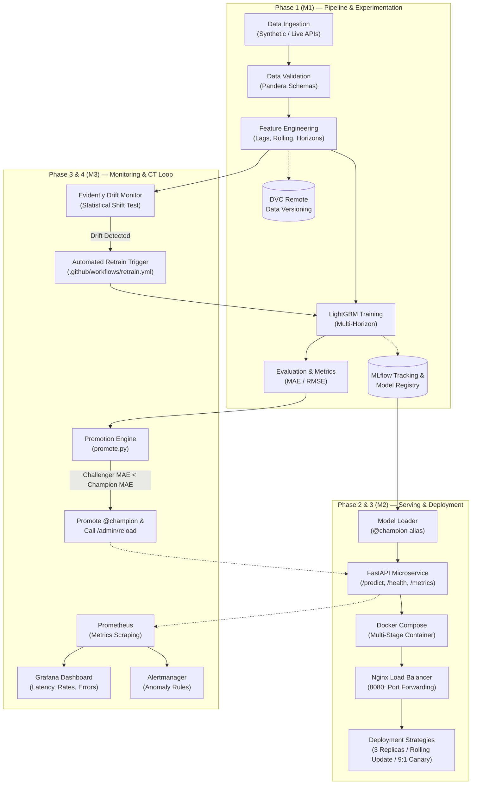

# AQI Forecaster MLOps: Continuous 24-Hour Air Quality Forecasting System


A production-grade, closed-loop MLOps system that forecasts the next 24 hours of Air Quality Index (AQI) for **Ahmedabad, Delhi, and Mumbai**. The system integrates automated data ingestion, Pandera schema validation, feature engineering, LightGBM model training with MLflow experiment tracking, containerized FastAPI serving behind an Nginx reverse proxy with zero-downtime rolling updates, Prometheus & Grafana observability, and automated Evidently continuous data-drift detection with champion-vs-challenger retraining and hot-reloading.

---

## 1. System Architecture



---

## 2. Requirement to File & Command Mapping

| Requirement Category | Owner | Implementing Files & Directories | Primary Execution Commands |
|---|---|---|---|
| **Data Versioning** | M1 | `dvc.yaml`, `params.yaml`, `.dvcignore`, `data/` | `dvc repro`, `dvc status` |
| **Pipeline Architecture** | M1 | `src/ingest/`, `src/validate/`, `src/features/`, `src/train/`, `src/evaluate/` | `python -m src.ingest.run`, `python -m src.validate.run`, `python -m src.features.run` |
| **Experiment Tracking** | M1 | `src/train/run.py`, `src/evaluate/run.py`, `metrics.json` | `python -m src.train.run --fast`, `mlflow ui` |
| **FastAPI Serving** | M2 | `api/app.py`, `api/schemas.py`, `api/metrics.py`, `api/model_loader.py` | `uvicorn api.app:app --port 8000`, `curl http://localhost:8000/health` |
| **Containerization** | M2 | `Dockerfile`, `docker-compose.yml`, `requirements-api.txt` | `docker build -t aqi-api .`, `docker compose up -d` |
| **Deployment Strategies** | M2 | `deploy/nginx/`, `deploy/docker-compose.*.yml`, `deploy/scripts/` | `./deploy/scripts/rolling_update.sh v1.1.0`, `./deploy/scripts/canary_demo.sh` |
| **Monitoring Stack** | M3 | `monitoring/prometheus.yml`, `alert_rules.yml`, `alertmanager.yml`, `grafana/` | `docker compose up -d prometheus grafana alertmanager` |
| **CI/CD Pipelines** | M3 | `.github/workflows/ci.yml`, `.github/workflows/cd.yml`, `scripts/deploy_local.sh` | PR check trigger on GitHub, `./scripts/deploy_local.sh` |
| **Continuous Training** | M3 | `src/drift/`, `.github/workflows/drift-check.yml`, `scripts/run_full_loop.sh` | `./scripts/run_full_loop.sh --factor 2.5 --fast` |
| **Git Scenario 1 (M1)** | M1 | `.pre-commit-config.yaml`, `git_scenarios/m1/` | `./git_scenarios/m1/scenario_m1.sh` |
| **Git Scenario 2 (M2)** | M2 | `git_scenarios/m2/` | `./git_scenarios/m2/scenario_m2.sh` |
| **Git Scenario 3 (M3)** | M3 | `git_scenarios/m3/` | `./git_scenarios/m3/scenario_m3.sh` |

---

## 3. Quick Start & Setup

### 3.1 Local Environment Setup
```bash
# Clone and enter directory
cd aqi-mlops

# Create and activate Python 3.11 virtual environment
python -m venv .venv
# Linux/macOS:
source .venv/bin/activate
# Windows PowerShell:
.venv\Scripts\Activate.ps1

# Install project dependencies
pip install -r requirements.txt

# Run full test suite (12 tests)
pytest -v tests/
```

### 3.2 Running the Pipeline Locally (Offline-First)
```bash
# Generate synthetic dataset (30 days for Ahmedabad, Delhi, Mumbai)
python -m src.ingest.run --source synthetic --days 30

# Validate with Pandera
python -m src.validate.run

# Compute lag, rolling, and calendar features
python -m src.features.run

# Train LightGBM model and register in MLflow
python -m src.train.run --fast

# Evaluate model and write metrics.json
python -m src.evaluate.run
```

### 3.3 Starting the API & Verification
```bash
# Start FastAPI service
python -m uvicorn api.app:app --host 0.0.0.0 --port 8000

# Test health endpoint (in separate terminal)
curl -i http://localhost:8000/health

# Test prediction endpoint
curl -X POST http://localhost:8000/predict \
  -H "Content-Type: application/json" \
  -d '{
    "city": "ahmedabad",
    "readings": {
      "pm25": 85.2, "pm10": 140.0, "no2": 30.1, "so2": 9.0,
      "co": 1.1, "o3": 40.0, "temperature": 29.0, "humidity": 55.0, "wind_speed": 3.2
    }
  }'
```

---

## 4. Docker & Production Deployment (No Kubernetes)

Kubernetes has been intentionally replaced with **Docker Compose + Nginx** to deliver production capabilities with zero hypervisor overhead.

### 4.1 Running Scaled Replicas behind Nginx
```bash
docker compose -f docker-compose.yml -f deploy/docker-compose.scale.yml up -d --scale api=3
```
Nginx listens on `http://localhost:8080` and distributes load round-robin across all 3 API replicas.

### 4.2 Zero-Downtime Rolling Update & Rollback
```bash
# Deploy new tag v1.1.0 with continuous background traffic probe
./deploy/scripts/rolling_update.sh v1.1.0

# Audit deployment log
./deploy/scripts/release_log.sh list

# Automated rollback to previous release
./deploy/scripts/rollback.sh
```

### 4.3 9:1 Weighted Canary Deployment
```bash
# Start stable and canary services
docker compose -f deploy/docker-compose.canary.yml up -d

# Send 200 requests and observe 90% stable vs 10% canary traffic
./deploy/scripts/canary_demo.sh --requests 200
```

---

## 5. Monitoring & Observability Stack

Launch Prometheus, Alertmanager, and Grafana:
```bash
docker compose up -d prometheus grafana alertmanager
```
- **Prometheus:** `http://localhost:9090` (Scrapes `api:8000/metrics` every 5s)
- **Grafana:** `http://localhost:3000` (User: `admin`, Password: `admin`)
  - Auto-provisioned Dashboard: **AQI MLOps Production Dashboard**
  - Live Panels: Request Rate, P95 Latency, Error Rate, Prediction Distribution, Active Model Version.
- **Alertmanager:** `http://localhost:9093` (Alert rules: `APIDown`, `HighErrorRate`, `HighLatencyP95`, `PredictionDistributionShift`)

---

## 6. Continuous Training Closed Loop

Run the complete feedback loop (Inject Drift $\rightarrow$ Detect Drift $\rightarrow$ Retrain $\rightarrow$ Compare $\rightarrow$ Promote $\rightarrow$ Reload):
```bash
./scripts/run_full_loop.sh --factor 2.5 --fast
```
Outputs:
- Drift Metrics: `reports/drift_metrics.json`
- Drift Visualization: `reports/drift_report.html`
- Promotion Verdict: `reports/promotion_decision.json`

---

## 7. Troubleshooting & FAQ

1. **Port 8000 or 8080 already in use:**
   ```bash
   # Windows:
   netstat -ano | findstr :8000
   taskkill /PID <PID> /F
   # Linux/macOS:
   lsof -i :8000 | awk 'NR>1 {print $2}' | xargs kill -9
   ```

2. **MLflow database locked:**
   Delete `mlflow.db` to regenerate a fresh SQLite backend or run MLflow server in docker compose.

3. **Offline execution without internet:**
   The entire system defaults to `synthetic` ingestion and local remote `../dvc-remote`. No active external connection is required to pass all tests or run demonstrations.